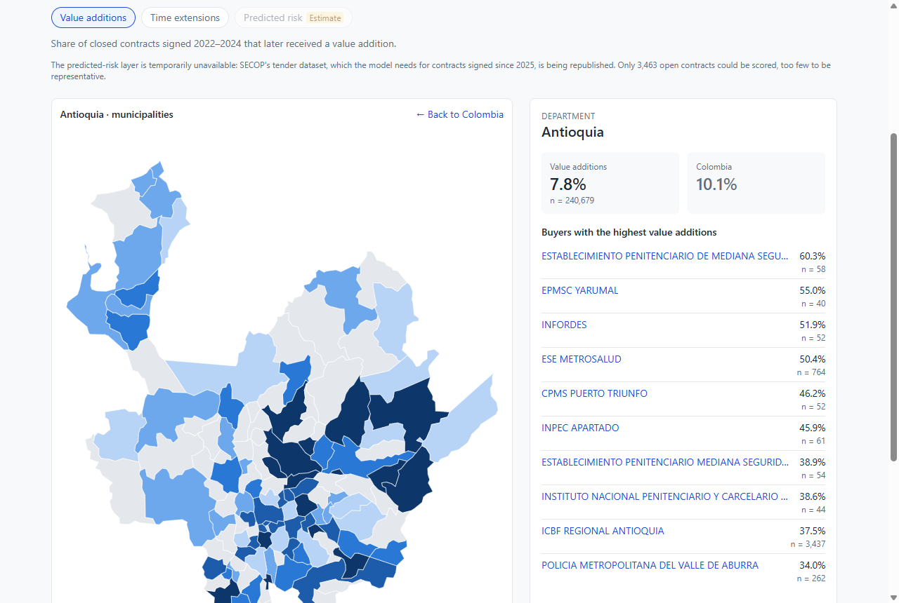
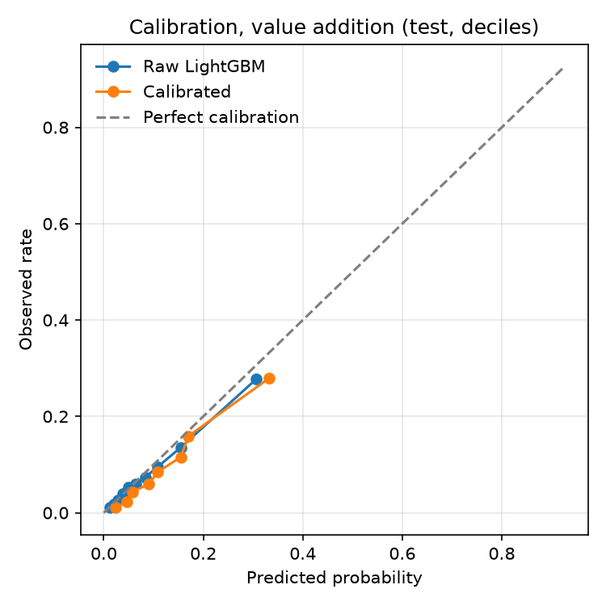
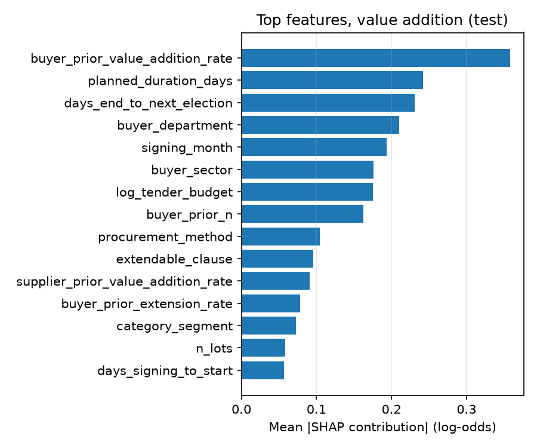

# Procurement Risk Radar

Predicting, **at signing time**, which public contracts will later be amended (value
additions and time extensions). An end-to-end machine learning system built on Colombia's
SECOP II open procurement data, designed around the
[Open Contracting Data Standard](https://standard.open-contracting.org/) so other
countries can be added.

> **Disclaimer.** Scores are statistical estimates for analysis, not allegations of
> wrongdoing. This project reports amendment risk signals; it does not detect or claim
> corruption or fraud.

**Live demo:** [procurement-risk-radar.vercel.app](https://procurement-risk-radar.vercel.app). It
has an interactive map, a page for each buyer, and a "try it" form backed by the
[prediction API](https://procurement-risk-radar-9p25.onrender.com/docs). The API runs on a free
instance that sleeps when idle, so the first request can take about a minute.

[](https://procurement-risk-radar.vercel.app)

**Status:** Phases 0–4 are complete: data audit, model, API, web demo, and automated weekly
scoring, monthly retraining and monitoring. See the [model card](docs/model-card.md),
[API reference](docs/api.md), [operations](docs/operations.md), [data audit](docs/data-audit.md)
and [geographic sources](docs/geo-sources.md).

## Results

Production model `model-2026-11-16`, from the monthly retrain on a rolling split by signing
date: train before 2023-11-16 (2.52M closed contracts), validation 2023-11-16 to 2024-05-16,
**test 2024-05-16 to 2025-11-16 (1.39M contracts)**. Every model is scored on the same test
rows.

| Target | Model | PR-AUC | ROC-AUC | Precision in top 5% |
|---|---|---:|---:|---:|
| Value addition (8.3% of test) | Base rate | 0.083 | 0.500 | 0.085 |
| | Buyer's historical rate | 0.190 | 0.698 | 0.289 |
| | Logistic regression | 0.222 | 0.726 | 0.308 |
| | **LightGBM (calibrated)** | **0.261** | **0.765** | **0.372** |
| Time extension (16.3% of test) | Base rate | 0.161 | 0.500 | 0.163 |
| | Buyer's historical rate | 0.323 | 0.680 | **0.512** |
| | Logistic regression | 0.332 | 0.682 | 0.502 |
| | **LightGBM (calibrated)** | **0.366** | **0.741** | 0.486 |

Among the 5% of contracts the model ranks highest, **37% end up with a value addition**, which
is 4.5 times the base rate. For time extensions the figure is 49%, or 3 times the base rate.
There the buyer's own extension history alone does slightly better in the top 5% (51%), but
LightGBM ranks the whole test period better (PR-AUC 0.366 against 0.323).

<p>
  
  
  
</p>

The strongest signals are the buyer's own amendment history, the planned duration, the
signing month (contracts signed early in the year are amended far more often), and the
buyer's sector and region.

Limitations, covered in full in the [model card](docs/model-card.md):

- The text-recovered labels have about 84% precision.
- SECOP does not publish the size of each addition, so the model predicts whether one
  happens, not how large it is.
- The most recent quarter shows a lower value-addition rate (5% for contracts signed in
  2024-Q4, against 6–14% earlier), so some late additions may not be recorded yet.

## How it works

1. **Ingestion and privacy.** SECOP II contracts, amendments and procurement processes are
   downloaded from the Socrata API into Parquet. Only allowlisted columns are kept, and
   natural-person suppliers are hashed with a secret salt.
2. **Canonical schema.** A Colombia adapter maps the raw tables into an OCDS-inspired schema
   (`award_value`, `n_bidders`, `planned_duration_days`, …), so another country only needs
   a new adapter.
3. **Labels.** A value addition counts when it is recorded as such *or* when a generic
   amendment's text describes one. The audit found 71% are hidden this way. A contract is
   labelled only once its planned end date is more than 180 days in the past.
4. **No leakage.** Every feature is known at signing time. Buyer and supplier history uses
   a point-in-time ASOF join, so a contract only sees labels that were observable before it
   was signed, and the test covers same-day and late-record edge cases.
5. **Models.** Three baselines and LightGBM, early-stopped on the validation period. Isotonic
   calibration is fitted on the validation period only. Ranking metrics use raw scores and
   probability metrics use calibrated ones.
6. **Tracking and explanations.** Runs, metrics and the calibrated model are registered in
   MLflow. Per-contract explanations are LightGBM SHAP contributions.

```bash
uv run python -m procurement_risk build-dataset --as-of 2026-11-14
uv run python -m procurement_risk train --target has_value_addition
uv run python -m procurement_risk train --target has_time_extension
uv run python -m procurement_risk model-card
```

## Prediction API

`POST /predict` takes the signing-time attributes of a contract and its buyer, and returns:

- the calibrated probability of a value addition and of a time extension;
- each probability's percentile against recent contracts;
- the top signals behind each score.

Features come from the **same SQL** used for training, which is checked by a parity test.
The service runs in Docker on Render's free plan ([`render.yaml`](render.yaml)). The model
bundle is downloaded from a GitHub Release and checked against its SHA-256 before use. On
every push, CI builds two images, starts each one and calls the API:

- one with a synthetic bundle;
- the production image with the real bundle, which was pickled on Windows and is loaded on
  Linux.

Render deploys only after those checks pass.

```bash
curl -s -X POST https://procurement-risk-radar-9p25.onrender.com/predict -H "Content-Type: application/json"   -d '{"contracts":[{"buyer_id":"700221021","signed_at":"2025-01-15","award_value":40000000,"planned_duration_days":330}]}'
```

See [docs/api.md](docs/api.md) for the fields, the response and the limitations.

## Operations

Three scheduled GitHub Actions workflows keep the system current. Details are in
[docs/operations.md](docs/operations.md).

- **Nightly:** archive SECOP contract values and end dates (`snapshot.yml`).
- **Weekly:** download SECOP, check data quality, rescore open contracts, update the drift
  and realized-performance monitoring and the amendment-size figures, and refresh the website
  data (`weekly-refresh.yml`).
- **Monthly:** retrain both models on a rolling split and compare them with production on
  the same test rows. When the new models pass the promotion gate, the workflow publishes a
  **draft** release and opens a pull request. A new model reaches production only after
  the release is published and the pull request is merged (`monthly-retrain.yml`).
- **Failures:** they open a GitHub issue labelled `pipeline`, and nothing is published from
  a bad download.

## Data audit

Key findings from the audit (contracts signed 2021–2022, 1.27M contracts):

- Most value additions (71%) are not recorded with the `Adicion en el valor` type; they hide under
  generic modifications and are recovered from the amendment text (84% precision on a manual check).
- `valor_del_contrato` already includes additions, and `estado_contrato` is not kept up to date, so
  both are excluded; the original value comes from the awarded amount of the procurement process.
- 86% of contracts are with natural persons, whose identities are hashed before storage.

## Data

Source: SECOP II open data published by Colombia Compra Eficiente on
[datos.gov.co](https://www.datos.gov.co): contracts (`jbjy-vk9h`), contract amendments
(`cb9c-h8sn`) and procurement processes (`p6dx-8zbt`).

Privacy: only an allowlist of columns is ever stored. Personal data in the source
(legal representatives, supervisors, bank accounts) is never written to disk, and
suppliers who are natural persons are replaced by a salted hash.

## Snapshot archive

SECOP publishes *that* a contract received a value addition, but not *how much*. To be able
to measure amendment size later, a nightly GitHub Actions job
([`snapshot.yml`](.github/workflows/snapshot.yml)) records every contract whose
`ultima_actualizacion` changed since the previous run: contract value, end date, added
days and status. Files are attached to the
[`snapshots` release](../../releases/tag/snapshots): `baseline-YYYY-MM-DD-HHMMSSZ.parquet` (full
download, also re-taken on the first day of each month) and `changes-YYYY-MM-DD-HHMMSSZ.parquet`. Files are never overwritten.

## Development

```bash
uv sync --all-extras
uv run pytest
uv run ruff check .

cd web && npm ci && npm test -- --run && npm run dev   # web demo on http://localhost:5173
```

## Web demo

`web/` is a React + TypeScript (Vite) app hosted on Vercel. It reads static JSON written by
`python -m procurement_risk export-web-data`, which uses the same features and models as the
API, and calls the live API for the "try it" form.

- The JSON contains no supplier names and no free text from contracts.
- Contracts with a natural-person supplier are listed without their identifier or link.
- Rates based on fewer than 30 contracts are hidden.

On 2026-11-15 SECOP truncated its tender dataset (`p6dx-8zbt`). The predicted-risk layer
stays switched off until at least 10,000 open contracts can be scored again.

## License

- Code: MIT, see [LICENSE](LICENSE).
- Data: SECOP II open data from Colombia Compra Eficiente on
  [datos.gov.co](https://www.datos.gov.co).
- Map boundaries: [geoBoundaries](https://www.geoboundaries.org/) (CC BY 4.0) and DANE DIVIPOLA
  ([CC BY-SA 4.0](https://creativecommons.org/licenses/by-sa/4.0/)); see
  [docs/geo-sources.md](docs/geo-sources.md).
