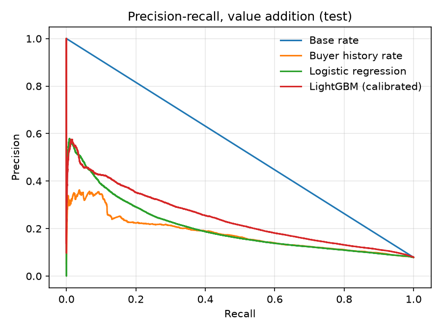

# Procurement Risk Radar

Predicting, **at signing time**, which public contracts will later be amended (value
additions and time extensions). An end-to-end machine learning system built on Colombia's
SECOP II open procurement data, designed around the
[Open Contracting Data Standard](https://standard.open-contracting.org/) so other
countries can be added.

> **Disclaimer.** Scores are statistical estimates for analysis, not allegations of
> wrongdoing. This project reports amendment risk signals; it does not detect or claim
> corruption or fraud.

**Status:** Phase 2 complete. A prediction API serves the calibrated model; see the
[API reference](docs/api.md), the [model card](docs/model-card.md) and the
[data audit](docs/data-audit.md). Next: Phase 3, a web demo with an interactive map.

**Live API:** _deployment pending_ (Hugging Face Space, `/docs` for the interactive reference).

## Results

Trained on 3.47M closed contracts signed 2019–2024 and split by signing date: train before
2023, validation 2023-H1, **test 2023-07 to 2024-12 (1.14M contracts)**. Every model is scored
on the same test period.

| Target | Model | PR-AUC | ROC-AUC | Precision in top 5% |
|---|---|---:|---:|---:|
| Value addition (7.9% of test) | Base rate | 0.079 | 0.500 | 0.078 |
| | Buyer's historical rate | 0.178 | 0.697 | 0.247 |
| | Logistic regression | 0.203 | 0.698 | 0.299 |
| | **LightGBM (calibrated)** | **0.243** | **0.758** | **0.344** |
| Time extension (11.3% of test) | Base rate | 0.113 | 0.500 | 0.111 |
| | Buyer's historical rate | 0.247 | 0.706 | 0.392 |
| | Logistic regression | 0.258 | 0.697 | 0.381 |
| | **LightGBM (calibrated)** | **0.323** | **0.763** | **0.448** |

Among the 5% of contracts the model ranks highest, **34% end up with a value addition**, which
is 4.4 times the base rate. For time extensions the figure is 45%, or 4 times the base rate.

<p>
  
  
  
</p>

The strongest signals are the buyer's own amendment history, the planned duration, the
signing month (contracts signed early in the year are amended far more often), and the
buyer's sector and region.

Limitations, covered in full in the [model card](docs/model-card.md):

- The text-recovered labels have about 84% precision.
- SECOP does not publish the size of each addition, so the model predicts whether one
  happens, not how large it is.
- The most recent quarter shows a lower value-addition rate (5% for contracts signed in
  2024-Q4, against 6–14% earlier), so some late additions may not be recorded yet.

## How it works

1. **Ingestion and privacy.** SECOP II contracts, amendments and procurement processes are
   downloaded from the Socrata API into Parquet. Only allowlisted columns are kept, and
   natural-person suppliers are hashed with a secret salt.
2. **Canonical schema.** A Colombia adapter maps the raw tables into an OCDS-inspired schema
   (`award_value`, `n_bidders`, `planned_duration_days`, …), so another country only needs
   a new adapter.
3. **Labels.** A value addition counts when it is recorded as such *or* when a generic
   amendment's text describes one. The audit found 71% are hidden this way. A contract is
   labelled only once its planned end date is more than 180 days in the past.
4. **No leakage.** Every feature is known at signing time. Buyer and supplier history uses
   a point-in-time ASOF join, so a contract only sees labels that were observable before it
   was signed, and the test covers same-day and late-record edge cases.
5. **Models.** Three baselines and LightGBM, early-stopped on the validation period. Isotonic
   calibration is fitted on the validation period only. Ranking metrics use raw scores and
   probability metrics use calibrated ones.
6. **Tracking and explanations.** Runs, metrics and the calibrated model are registered in
   MLflow. Per-contract explanations are LightGBM SHAP contributions.

```bash
uv run python -m procurement_risk build-dataset --as-of 2026-11-14
uv run python -m procurement_risk train --target has_value_addition
uv run python -m procurement_risk train --target has_time_extension
uv run python -m procurement_risk model-card
```

## Prediction API

`POST /predict` takes the signing-time attributes of a contract and its buyer, and returns:

- the calibrated probability of a value addition and of a time extension;
- each probability's percentile against recent contracts;
- the top signals behind each score.

Features come from the **same SQL** used for training, which is checked by a parity test.
The service runs in Docker on a Hugging Face Space, and CI builds the image, starts it and
calls the API on every push.

```bash
curl -s -X POST <api-url>/predict -H "Content-Type: application/json"   -d '{"contracts":[{"buyer_id":"700221021","signed_at":"2025-01-15","award_value":40000000,"planned_duration_days":330}]}'
```

See [docs/api.md](docs/api.md) for the fields, the response and the limitations.

## Data audit

Key findings from the audit (contracts signed 2021–2022, 1.27M contracts):

- Most value additions (71%) are not recorded with the `Adicion en el valor` type; they hide under
  generic modifications and are recovered from the amendment text (84% precision on a manual check).
- `valor_del_contrato` already includes additions, and `estado_contrato` is not kept up to date, so
  both are excluded; the original value comes from the awarded amount of the procurement process.
- 86% of contracts are with natural persons, whose identities are hashed before storage.

## Data

Source: SECOP II open data published by Colombia Compra Eficiente on
[datos.gov.co](https://www.datos.gov.co): contracts (`jbjy-vk9h`), contract amendments
(`cb9c-h8sn`) and procurement processes (`p6dx-8zbt`).

Privacy: only an allowlist of columns is ever stored. Personal data in the source
(legal representatives, supervisors, bank accounts) is never written to disk, and
suppliers who are natural persons are replaced by a salted hash.

## Snapshot archive

SECOP publishes *that* a contract received a value addition, but not *how much*. To be able
to measure amendment size later, a nightly GitHub Actions job
([`snapshot.yml`](.github/workflows/snapshot.yml)) records every contract whose
`ultima_actualizacion` changed since the previous run: contract value, end date, added
days and status. Files are attached to the
[`snapshots` release](../../releases/tag/snapshots): `baseline-YYYY-MM-DD-HHMMSSZ.parquet` (full
download, also re-taken on the first day of each month) and `changes-YYYY-MM-DD-HHMMSSZ.parquet`. Files are never overwritten.

## Development

```bash
uv sync --all-extras
uv run pytest
uv run ruff check .
```

## License

Code: MIT, see [LICENSE](LICENSE).
