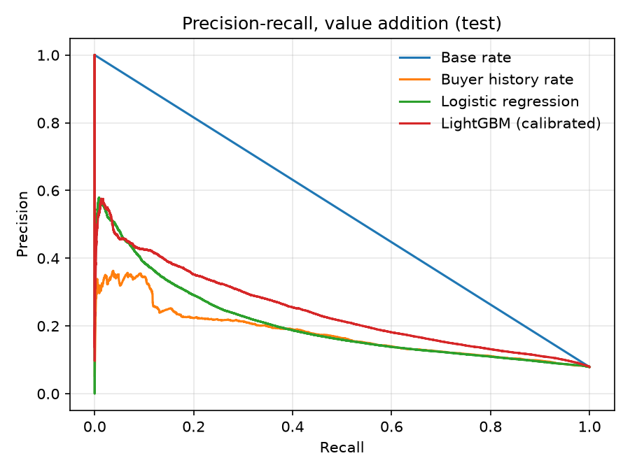
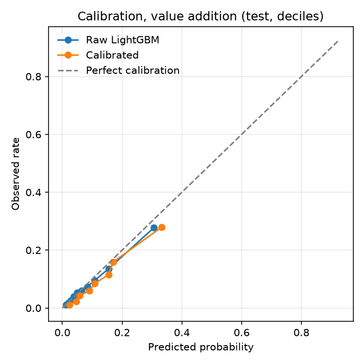
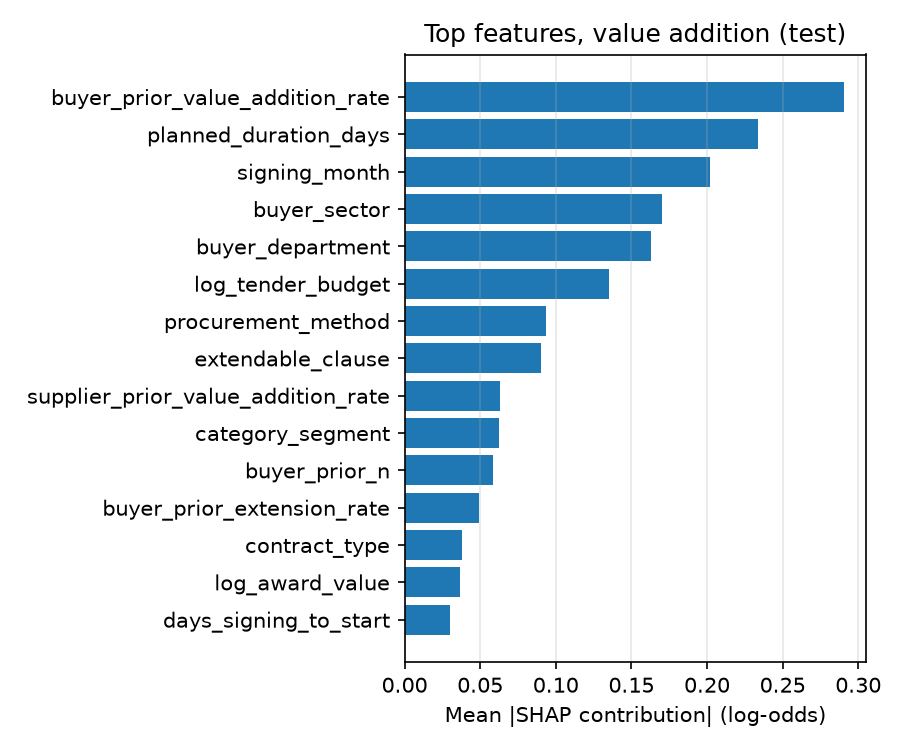
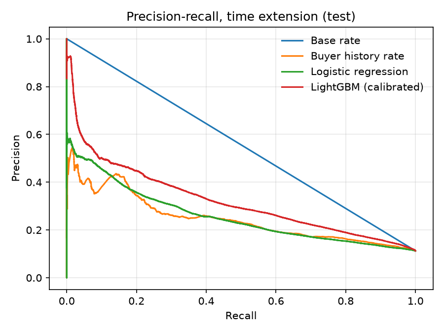
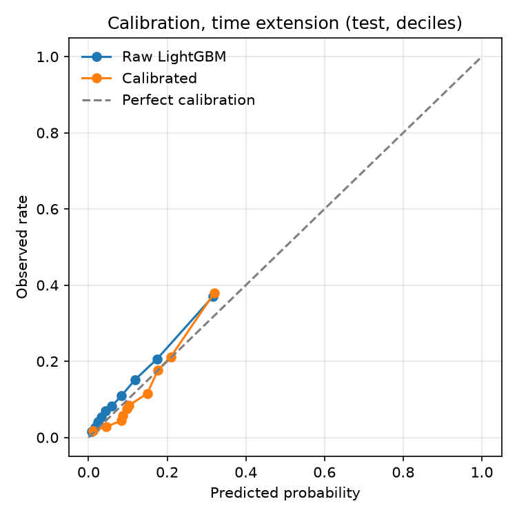
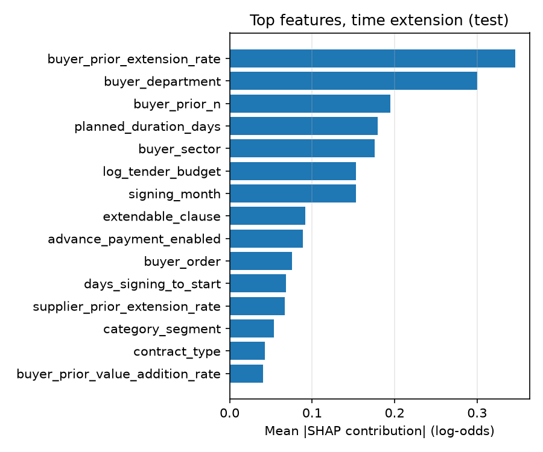

# Model card: amendment risk at signing time

> Scores are statistical estimates for analysis, not allegations of wrongdoing. They estimate the chance that a contract will be amended, nothing more.

## Intended use

Estimate, at the moment a Colombian public contract is signed, the probability that it
will later receive a value addition (primary target) or a time extension (secondary
target), to help analysts, journalists and oversight bodies prioritise review. Not for
decisions about individual people or suppliers.

## Data

- Source: SECOP II open data (datos.gov.co), contracts signed 2019-01-01 to 2024-12-31; 3,468,109 closed contracts.
- Closed contract: planned end date (planned start + planned duration, falling back to the current end date) at least 180 days before 2026-11-14. Only closed contracts are labelled. The current end date is not used because extensions move it, which would drop extended contracts from recent periods.
- `has_value_addition` (10.9% positive): an explicit 'Adicion en el valor' amendment, or a generic amendment whose text describes a value addition (see [data audit](data-audit.md)).
- `has_time_extension` (11.3% positive): added days > 0 or an 'Extension' amendment.
- Temporal split by signing date: train before 2023-01-01 (1,762,947), validation 2023-H1 (565,140), test 2023-07-01 to 2024-12-31 (1,140,022).

## Features

Only information known at signing time.

- Categorical: `buyer_department`, `buyer_order`, `buyer_sector`, `buyer_branch`, `buyer_centralized`, `procurement_method`, `contract_type`, `category_segment`, `funding_source`.
- Numeric: `log_award_value`, `log_tender_budget`, `award_to_budget_ratio`, `planned_duration_days`, `days_publication_to_signing`, `days_signing_to_start`, `n_bidders`, `single_bidder`, `n_responses`, `n_invited`, `n_lots`, `signing_month`, `signed_in_december`, `supplier_is_natural_person`, `supplier_is_sme`, `supplier_is_group`, `advance_payment_enabled`, `extendable_clause`, `buyer_prior_n`, `buyer_prior_value_addition_rate`, `buyer_prior_extension_rate`, `supplier_prior_n`, `supplier_prior_value_addition_rate`, `supplier_prior_extension_rate`.
- Buyer and supplier history use only labels observable before the signing date (end date + 180 days), smoothed toward the training-period rate.
- Excluded: current contract value (already includes additions), current end date and stated duration (moved by extensions), added days, contract status (stale), payments, identifiers and supplier names.

## Evaluation (test split)

Ranking metrics (PR-AUC, ROC-AUC, precision and recall in the top 5%) use raw LightGBM scores; Brier score and log loss use the calibrated probabilities. Ties at the top-5% cutoff are broken at random with a fixed seed.

### `has_value_addition`

| Model | PR-AUC | ROC-AUC | Brier | Log loss | Precision @ top 5% | Recall @ top 5% |
|---|---:|---:|---:|---:|---:|---:|
| Base rate | 0.079 | 0.500 | 0.0744 | 0.2853 | 0.078 | 0.050 |
| Buyer history rate | 0.178 | 0.697 | 0.0727 | 0.2671 | 0.247 | 0.157 |
| Logistic regression | 0.203 | 0.698 | 0.0688 | 0.2575 | 0.299 | 0.190 |
| LightGBM (calibrated) | 0.243 | 0.758 | 0.0673 | 0.2475 | 0.344 | 0.218 |

### `has_time_extension`

| Model | PR-AUC | ROC-AUC | Brier | Log loss | Precision @ top 5% | Recall @ top 5% |
|---|---:|---:|---:|---:|---:|---:|
| Base rate | 0.113 | 0.500 | 0.1001 | 0.3525 | 0.111 | 0.049 |
| Buyer history rate | 0.247 | 0.706 | 0.0943 | 0.3371 | 0.392 | 0.174 |
| Logistic regression | 0.258 | 0.697 | 0.0942 | 0.3294 | 0.381 | 0.169 |
| LightGBM (calibrated) | 0.323 | 0.763 | 0.0894 | 0.3095 | 0.448 | 0.199 |

## Model

LightGBM gradient boosting, early-stopped on the validation split by average precision,
with isotonic calibration fitted on the validation split only. Explanations are SHAP
contributions computed by LightGBM. Runs and the registered model are tracked in MLflow.

## Limitations

- Label noise: value additions recovered from text come from a keyword matcher with 84% precision on a manual check of 50 cases; some additions with unusual wording are missed.
- The size of each addition is not published by SECOP; the model predicts whether an addition happens, not how large it is.
- `estado_contrato` is not kept up to date, so closure is inferred from planned end dates. Contracts signed in the most recent months are only included once their planned end has passed, so the test period over-represents shorter contracts.
- Colombia only; data lag of about two days behind the SECOP portal.
- A high score reflects patterns of similar past contracts, not evidence about this one.

## Ethical considerations

- Natural-person suppliers are replaced by a salted hash before storage; their names and ID numbers never enter the dataset, figures or reports.
- Public views aggregate by entity, region and contract type; there are no supplier rankings.
- Outputs are framed as amendment risk signals and always shown with the disclaimer above.
